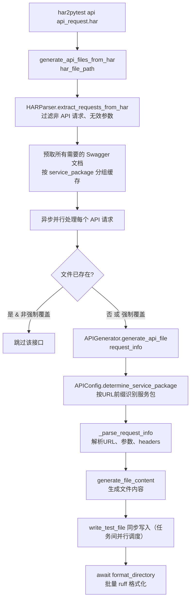
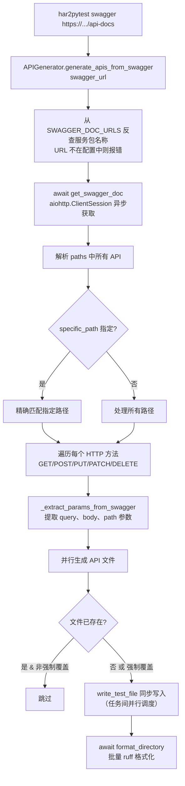

# API 文件生成两种方式详解

## 概述

`har2pytest` 提供两种方式生成 API 文件，每种方式适用于不同的场景：

| 方式 | 命令 | 输入源 | 适用场景 | 依赖 |
|------|------|--------|---------|------|
| **HAR 文件生成** | `har2pytest api` | `.har` 抓包文件 | 已有抓包数据，需要快速生成项目已有的 API 定义 | HAR 文件 + 网络配置 |
| **Swagger 文档生成** | `har2pytest swagger` | Swagger JSON URL | 后端提供了 Swagger 文档，需要生成完整的 API 定义 | Swagger 文档 URL |

---

## 方式一：从 HAR 文件生成 API 文件

### 用途

通过解析浏览器或工具抓取的 HAR（HTTP Archive）文件，自动提取其中的 API 请求信息，生成项目的 Python API 接口文件。

### 调用链



### 详细步骤

#### Step 1: `generate_api_files_from_har()`（异步，并行处理）

```
输入: har_file_path
 └─ 校验 HAR 文件存在
 └─ HARParser.extract_requests_from_har() → 提取 API 请求列表
 │     过滤规则:
 │     - 移除非 API 请求（CSS、JS、图片等）
 │     - 过滤无效参数（rnd、timestamp 等，由 APIConfig.INVALID_PARAMS 定义）
 │     - 可选去重（filter_duplicate_url=True 时同 method+url 只保留第一个）
 │
 └─ 预取 Swagger 文档:
 │     按 service_package 分组，预先获取所有需要的 Swagger 文档
 │     避免后续每个请求各自并发获取导致竞态条件
 │
 └─ 异步并行处理（asyncio.as_completed）:
 │     每个 API 请求并发执行 generate_api_file()
 │     Swagger 文档通过 swagger_doc 参数传入
 │     文件写入通过 write_test_file() 同步执行（任务间并行调度）
 │     全部文件写完后由 format_directory() 异步批量 ruff 格式化
 │
 └─ 所有请求处理完毕后 → await format_directory(output_dir) 一次性 ruff 格式化
```

> **并行处理说明**：所有 API 请求通过 `asyncio.as_completed` 并行处理，Swagger 文档在处理前预取缓存，通过 `swagger_doc` 参数传入各任务。生成完毕后对整个输出目录进行一次性 ruff 格式化。

#### Step 2: `check_api_exists()`

```
输入: url, service_package, function_name（可选）
 └─ 通过 URLMatcher.generate_function_name() 生成函数名（缺省由 url 推导）
 └─ 检查根目录及服务包目录下是否已存在同名文件
 └─ 返回 True/False
```

#### Step 3: `determine_service_package()`

根据 URL 前缀自动识别服务包，决定文件存放目录。
映射关系由配置文件 `SERVICE_MAPPING` 决定（非硬编码），示例：

| URL 前缀 | 服务包目录 |
|---------|-----------|
| `/mobile/...` | `mobile_application`（由 `SERVICE_MAPPING` 配置） |
| 未匹配前缀 | 默认 `apis`（由 `DEFAULT_API_DIR` 配置） |

##### Step 4: `_parse_request_info()`

解析请求信息的核心步骤：

```
输入: request_info（ParsedRequestInfo: method, url, query_params, post_data, headers）
 └─ 处理 headers：
 │     - 补充 APIConfig.REQUIRED_HEADERS 中的默认字段（如 authorization）
 │     - 注：HEADERS_TO_INCLUDE 过滤在 HARParser._filter_headers() 中完成
 │
 └─ 检测上传类型：
 │     - content-type 含 "multipart/form-data" 且检测到文件上传字段 → is_file_upload = True
 │     - POST 且无有效请求体（非 multipart 且 content-length=0，或空 JSON body 带 query 参数）
 │       → is_need_urlencode = True（application/x-www-form-urlencoded 传参）
 │
 └─ URL 匹配：
       - URLMatcher 识别路径参数模式（如 /user/{id}/detail）
       - 提取 path_params（如 {"id": "123"}）
       - 生成 URL 模板（如 /user/{params['id']}/detail）
```

#### Step 5: `generate_file_content()`

生成 API 文件的完整内容，包含以下部分：

```
├── imports 部分
│   ├── import os
│   ├── from har2pytest.client import client
│   └── 文件上传时额外导入:
│       └── from har2pytest.client import client, build_multipart_data
│
├── params 参数定义（如有参数）
│   ├── params = { ... }    # GET 请求的查询参数
│   ├── data = { ... }      # POST 请求的 body 参数
│   └── files = { ... }     # 文件上传参数
│   每个参数带注释: key: value,  # 参数说明
│
├── headers 定义
│   └── headers = { "authorization": f"bearer {os.environ['token']}", ... }
│
└── 函数定义
    ├── def function_name(params=params, headers=headers):
    │       接口描述 / URL 路径
    │       参数说明（来自 Swagger 文档，如有）
    │
    ├── url = "/api/example"
    │   路径参数时: url = f"/user/{params['id']}/detail"
    │
    └── 请求调用:
        ├── GET:  client.get(url=url, params=params, headers=headers)
        ├── POST: client.post(url=url, json=data, headers=headers)
        ├── 文件上传: build_multipart_data + client.post(url=url, data=data, headers=headers)
        ├── Multipart表单: build_form_data + client.post(url=url, data=m, headers=headers)
        └── URL编码: client.post(url=url, data=urlencode(data), headers=headers)
```

### 生成示例

#### 示例 1：GET 请求（列表查询）
```python
import os

from har2pytest.client import client

params = {
    "keyword": "",              # 关键字搜索
    "pageNum": 0,               # 页数
    "pageSize": 10,              # 页大小
}

headers = {
    "authorization": f"bearer {os.environ['token']}",
}


def mobile_order_list(params=params, headers=headers):
    """
    订单分页查询
    /mobile/order/list

    参数说明:
    - keyword: 关键字搜索
    - pageNum: 页数
    - pageSize: 页大小
    """

    url = "/mobile/order/list"
    return client.get(url=url, params=params, headers=headers)
```

#### 示例 2：POST 请求（带 data）
```python
import os

from har2pytest.client import client

data = {
    "orderNo": "",           # 订单号
    "customerPhone": "",     # 客户手机号
    "pageNum": 0,            # 页数
    "pageSize": 10,           # 页大小
}

headers = {
    "authorization": f"bearer {os.environ['token']}",
    "content-type": "application/json",
}


def order_export_handledDetail(data=data, headers=headers):
    """
    明细导出
    /order/export/handledDetail
    """

    url = "/order/export/handledDetail"
    return client.post(url=url, json=data, headers=headers)
```

#### 示例 3：路径参数接口
```python
import os

from har2pytest.client import client

params = {
    "id": "123",
}

headers = {
    "authorization": f"bearer {os.environ['token']}",
}


def mobile_order_id(params=params, headers=headers):
    """
    订单详情
    /mobile/order/{id}
    """

    url = f"/mobile/order/{params['id']}"
    return client.get(url=url, params=params, headers=headers)
```

---

## 方式二：从 Swagger 文档生成 API 文件

### 用途

直接从后端的 Swagger/OpenAPI 文档中读取接口定义，自动生成项目的 API 文件。这种方式生成的参数类型更准确，且自带接口描述和参数说明。

### 调用链



### 详细步骤

#### Step 1: `generate_apis_from_swagger()`

```
输入: swagger_url, force_overwrite=False, specific_path=None
 └─ 服务包解析:
 │     通过 _resolve_service_package_for_swagger_url() 反查 SWAGGER_DOC_URLS
 │     将 swagger_url 与配置中各 URL 清洗后比对，匹配到对应的键名即为服务包
 │     未匹配到 → 抛出 ValueError，提示在 SWAGGER_DOC_URLS 中添加配置
 │
 └─ await get_swagger_doc() → 异步获取 Swagger 文档数据（含缓存）
 │     aiohttp.ClientSession 发送 HTTP 请求
 │
 └─ 设置 url_matcher.swagger_data:
 │     将 Swagger 文档数据设置到 url_matcher，确保路径参数提取正确
 │
 └─ 解析 basePath + paths:
 │     basePath: /api
 │     paths:
 │       /user/list: { get: { ... } }
 │       /user/{id}: { get: { ... }, put: { ... } }
 │
 └─ 如果指定了 specific_path，只处理匹配的路径
 │     （自动处理 basePath 前缀）
 │
└─ 并行处理:
│     每个 path + method 组合通过 asyncio.as_completed 并行执行:
│       _extract_params_from_swagger() → 提取参数
│       generate_api_file() → 生成文件内容
│       write_test_file() → 同步写盘（任务间并行调度）
│
└─ 所有文件生成完毕后 → await format_directory(output_dir) 一次性 ruff 格式化
```

> **并行处理说明**：Swagger 文档使用 `httpx.AsyncClient` 异步获取；多个 API 文件通过 `asyncio.as_completed` 并行生成。swagger_data 在处理前统一设置到 url_matcher，各任务只读不写，无竞态条件。生成完毕后对整个输出目录进行一次性 ruff 格式化。

#### Step 2: `_extract_params_from_swagger()`

从 Swagger 文档中提取参数，分类处理：

```
输入: parameters 数组, swagger_data
 │
 ├── in: query → query_params（查询参数）
 │   例: { name: "pageNum", type: "integer" } → pageNum: 0
 │
 ├── in: path → path_params（路径参数）
 │   例: { name: "id", type: "string" } → id: ""
 │
 ├── in: body / $ref → post_data（body 参数）
 │   例: { name: "order", schema: { $ref: "#/definitions/Order" } }
 │   → 递归解析 $ref → 展开为完整数据结构
 │
 └── 所有参数添加默认值:
       string → ""
       integer → 0
       number → 0.0
       boolean → False
       array → []
       object → {}
```

#### Step 3: 生成 API 文件

Swagger 方式额外传入 `swagger_info` 参数，HAR 方式在 `generate_api_file()` 内部也会自动查询 Swagger 填充元信息，最终效果一致：

- 接口描述（summary）自动填充
- 参数说明（description）自动填充到注释中
- 函数注释中包含完整的参数说明列表

### 生成示例

```python
import os

from har2pytest.client import client

params = {
    "pageNum": 0,            # 页码
    "pageSize": 10,           # 每页数量
    "keyword": "",           # 关键字
}

headers = {
    "authorization": f"bearer {os.environ['token']}",
}


def mgmt_user_list(params=params, headers=headers):
    """
    用户列表查询
    /mgmt/user/list

    参数说明:
    - pageNum: 页码
    - pageSize: 每页数量
    - keyword: 关键字
    """

    url = "/mgmt/user/list"
    return client.get(url=url, params=params, headers=headers)
```

---

## 两种方式对比

| 维度 | HAR 文件生成 | Swagger 文档生成 |
|------|-------------|-----------------|
| **数据来源** | 浏览器/工具抓包的 `.har` 文件 | 后端提供的 Swagger JSON 文档 |
| **参数值** | 实际请求中的真实值 | 类型的默认值（0、""、False） |
| **接口描述** | 有 Swagger 时自动填充，无 Swagger 时为 TODO 占位 | 自动填充 summary |
| **参数说明** | 有 Swagger 时自动填充，无 Swagger 时为空 | 自动填充 description |
| **请求类型覆盖** | 只包含抓包中实际出现的接口 | 文档中定义的所有接口 |
| **路径参数** | 通过 URL 模式匹配识别 | 通过 in: path 精确识别 |
| **文件上传** | 自动检测 multipart/form-data | 通过参数类型检测 |
| **建议使用场景** | 已有抓包数据快速生成 | 后端文档完备时批量生成 |

---

## 常用命令

### 从 HAR 文件生成

```bash
# 基本用法（默认使用当前目录的 api_request.har，输出到 apis/）
har2pytest api

# 指定 HAR 文件和输出目录
har2pytest api api_request.har --output apis

# 强制覆盖已存在的文件
har2pytest api api_request.har --output apis --overwrite
```

### 从 Swagger 文档生成

```bash
# 基本用法
har2pytest swagger https://taobao.com/sw/order-application/v2/api-docs

# 指定输出目录
har2pytest swagger https://taobao.com/sw/order-application/v2/api-docs --output apis

# 强制覆盖已存在的文件
har2pytest swagger https://taobao.com/sw/order-application/v2/api-docs --overwrite

# 只生成指定路径的 API 文件
har2pytest swagger https://taobao.com/sw/order-application/v2/api-docs --path /mgmt/user/list

# 组合使用
har2pytest swagger https://taobao.com/sw/order-application/v2/api-docs --output apis --overwrite --path /mgmt/user/list
```

### 同步/异步统一说明

API 文件不再区分同步和异步模式，始终生成一套代码，运行时自动适配：

| 特性 | 说明 |
|------|------|
| 客户端导入 | `from har2pytest.client import client`（`client` 是 `_ClientProxy` 代理） |
| 文件上传 | `from har2pytest.client import client, build_multipart_data`（自动适配同步/异步） |
| 同步测试 | 默认使用 `Client`（requests），测试用例用 `with func() as r:`，响应字段 `r.status_code` / `r.json()` |
| 异步测试 | 测试用例加 `--async` 生成，导入部分自动添加 `client.set_client(async_client)`，用 `async with func() as r:`，响应字段 `r.status` / `await r.json()` |

---

## 最佳实践

### 推荐流程

```bash
# 1. 从 Swagger 文档生成 API 文件（获得完整的接口列表和参数说明）
har2pytest swagger https://taobao.com/sw/order-application/v2/api-docs --output apis

# 2. 从 HAR 文件补充缺失的接口（覆盖 Swagger 中未定义的接口）
har2pytest api api_request.har --output apis

# 3. 生成测试用例（list_query/complex_scenario 模式需用 --url 指定目标接口）
har2pytest testcase api_request.har --pattern list_query --url /api/user/list --mark test_4291
```

### 注意事项

1. **优先使用 Swagger 文档生成**：参数类型准确、自带描述说明
2. **SWAGGER_DOC_URLS 配置**：Swagger 命令要求 URL 必须在配置文件的 `SWAGGER_DOC_URLS` 中注册，否则会报错；服务包目录名由配置的键名决定（而非 `SERVICE_MAPPING`）
3. **HAR 文件补充**：对于 Swagger 文档中未覆盖的接口，通过 HAR 文件生成然后手动补充参数说明
4. **路径参数处理**：路径参数接口会自动生成 `f-string` 格式的 URL，无需手动替换
5. **Swagger 文档缓存**：获取到的 Swagger 文档会缓存，避免重复请求

---

## API 元数据与结构化读取

生成的每个 API 模块（`<function_name>.py`）旁会同步写一份结构化元数据
`<function_name>.api.json`（见 `har2pytest/api_metadata.py`），固化生成时
已知的规范信息：

| 字段 | 说明 |
|------|------|
| `url` | 规范化接口路径（含路径参数模板） |
| `description` | docstring 首行描述 |
| `method` | HTTP 方法 |
| `service_package` | 所属微服务目录 |
| `param_remarks` | 参数说明字典（嵌套参数用 dotted key） |
| `params` / `data` / `files` / `headers` | 生成时写入模块级赋值的**当前值**快照 |

下游（URL 匹配、测试用例生成）只消费这份元数据（`utils.parse_api_file` 为唯一
入口），**不再解析源码/docstring 去反解 url/描述/备注**；`params/data/files/headers`
的当前值同样以 API 元数据为准。生成测试用例前请确保每个 API 文件都有对应的
`.api.json`：缺失元数据或缺少必需字段（如 `url`）时 `parse_api_file` 会**报错
提示补充**，重新生成该 API 文件（`--overwrite`）即可自动补齐。

> 注意：API 元数据是“生成时”快照，重新生成 API 文件会自动刷新；新增/改造
> API 后请重新生成，避免缺元数据导致下游报错。

## 代码生成模板

缩进敏感的代码骨架（函数定义、HTTP 调用分支、三种测试模式的方法体、
断言、步骤函数、headers 属性等）由 `har2pytest/templates/*.j2` Jinja2
模板渲染（渲染入口见 `har2pytest/codegen.py`），避免手工拼接缩进；模块级
`params`/`data`/`headers` 等字面量仍由 `utils` 的格式化工具生成。生成
内容在写盘前会经过 `ast.parse` 语法校验，模板错误在生成期即可暴露。
