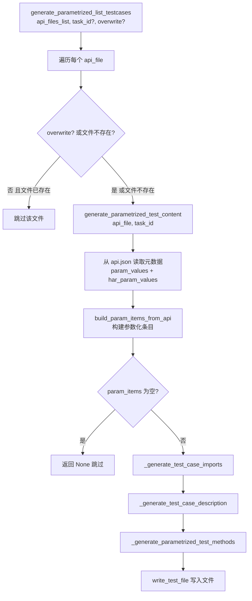
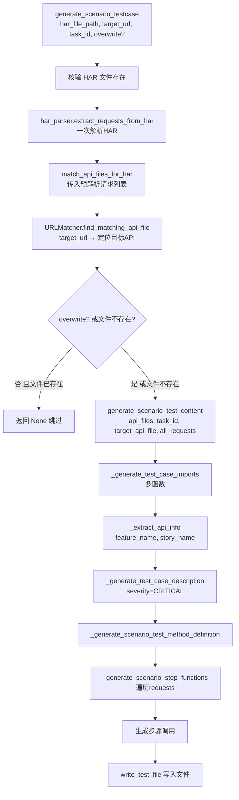
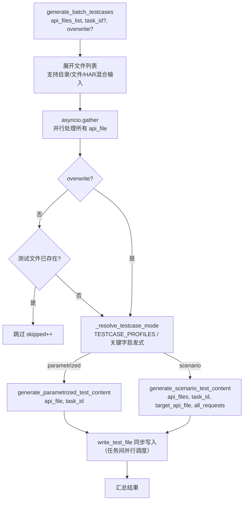

# 测试用例生成三种模式详解

## 概述

`TestCaseGenerator` 提供三种测试用例生成模式，每种模式适用于不同的测试场景：

| 模式 | 入口方法 | 参数来源 | 适用场景 |
|------|---------|---------|---------|
| **parametrized_list** | `generate_parametrized_list_testcases()` | api.json 元数据 | 列表查询接口的 pytest 参数化测试 |
| **complex_scenario** | `generate_scenario_testcase()` | HAR 文件 | 多步骤业务流程的链路测试 |
| **batch** | `generate_batch_testcases()` | API 文件 / HAR 文件 | 批量从 API 定义文件或 HAR 文件直接生成测试用例 |

---

## 模式一：parametrized_list（列表查询参数化模式）

### 用途

为列表查询类接口生成 `@pytest.mark.parametrize` 参数化测试用例。每个参数独立为一个测试方法，覆盖该参数的不同取值。

### 调用链



### 详细步骤

#### Step 1: `generate_parametrized_list_testcases()`

```
输入: api_files_list, task_id?, overwrite=False
 └─ 遍历每个 api_file:
      ├─ 若 overwrite=False 且文件已存在 → 跳过
      ├─ 调用 generate_parametrized_test_content() 生成内容
      └─ write_test_file() 写入文件
```

#### Step 2: `generate_parametrized_test_content()`

```
输入: api_file, task_id
 └─ parse_api_file(api_file) → 获取 function_name, url, params, data, param_remarks, param_values, har_param_values
 └─ _extract_api_info(api_file) → feature_name, story_name
 └─ 合并 api_info["params"] 和 api_info["data"] 得到 api_params
 │
 ├─ [参数来源]
 │  └─ merged_pv = api_info.param_values + api_info.har_param_values
 │     （param_values 来自 Swagger 类型感知默认值，har_param_values 来自 HAR 派生枚举元数据）
 │
 ├─ build_param_items_from_api(api_params, merged_pv) → 构建参数化条目
 │
 ├─ 无参数 → 返回 None
 │
 └─ [生成代码]
      ├─ _generate_test_case_imports(单函数)
    ├─ _generate_test_case_description(severity="NORMAL")
     └─ _generate_parametrized_test_methods(param_items, ...)
```

#### Step 3: `build_param_items_from_api()`

```
输入: api_params, merged_pv
 └─ 遍历 api_params 中的每个参数:
      ├─ 过滤分页参数、时间参数
      ├─ 从 merged_pv 中获取该参数的枚举值
      ├─ 单值参数 → 跳过（不参与参数化）
      ├─ 多值参数 → 构建 {param_name: values, other_params: {...}}
      └─ 组合参数（>1 个有效参数）→ 按排序后的逗号连接名组合
 └─ 返回 [{param_name: values, other_params: {...}}, ...]
```

> **说明**：`merged_pv` 由 `api_info.param_values`（Swagger 类型感知默认值）和 `api_info.har_param_values`（HAR 派生枚举元数据）合并而成。测试生成阶段不直接解析 HAR 文件，而是从 `api.json` 元数据中读取预计算的参数值。

> **回退机制**：若参数化模式无可用参数（所有参数均无法提取有效值），会回退调用 `generate_scenario_test_content()` 生成场景测试；场景模式也无内容时才最终跳过。

#### Step 4: `_generate_parametrized_test_methods()`

```
输入: param_items, api_description, function_name, request_method, param_remarks
 └─ 遍历 param_items:
      ├─ _generate_parametrize_decorator(param_name, values, is_combination)
      │    ├─ 单参数: @pytest.mark.parametrize("param", [v1, v2, ...])
      │    └─ 组合: @pytest.mark.parametrize("a,b", [(v1,v2), ...])
      ├─ _generate_test_method_definition(title, method_name, params)
      │    ├─ @allure.title("描述: 参数说明 查询")
      │    └─ def test_N_funcname(self, param):
      ├─ _generate_test_method_body(param_var_name, param_name, other_params)
      │    ├─ 构建 {param_name: param_value, other_key: other_value, ...}
      │    └─ data = {...} 或 params = {...}
      └─ _generate_test_method_assertions(function_name, param_var_name)
           └─ with function_name(params=params) as r:
              assert r.status_code == 200
              assert r.json()['code'] == 200
```

### 生成的测试用例示例

```python
import pytest
import allure
from allure_commons.types import Severity
from apis.mall_center import list_page

@allure.severity(Severity.NORMAL)
@allure.feature('mall_center')
@allure.story('/api/mall/list')
class TestClass:

    @pytest.mark.parametrize("status", [1, 2, 3])
    @allure.title("商品列表: status 查询")
    def test_0_list_page(self, status):
        params = {
            "status": status,
            "page": "1",
            "page_size": "20",
        }
        with list_page(params=params) as r:
            assert r.status_code == 200
            data = r.json()
            assert data['code'] == 200

    @pytest.mark.parametrize("category_id", ["1001", "1002"])
    @allure.title("商品列表: category_id 查询")
    def test_1_list_page(self, category_id):
        params = {
            "category_id": category_id,
            "page": "1",
            "page_size": "20",
        }
        with list_page(params=params) as r:
            assert r.status_code == 200
            data = r.json()
            assert data['code'] == 200
```

---

## 模式二：complex_scenario（复杂场景流程模式）

### 用途

为多步骤业务流程生成场景化链路测试用例。每个步骤对应一个 `@allure.step` 嵌套函数，测试数据在步骤间传递。

### 调用链



### 详细步骤

#### Step 1: `generate_scenario_testcase()`

```
输入: har_file_path, target_url, task_id, overwrite=False
 └─ 校验 HAR 文件存在
 └─ har_parser.extract_requests_from_har() → 一次解析 HAR
 └─ match_api_files_for_har(har_file_path, all_requests) → 传入预解析请求列表
 └─ URLMatcher.find_matching_api_file(target_url, api_files) → 目标 API 文件
 └─ 若 overwrite=False 且文件已存在 → 返回 None 跳过
 └─ generate_scenario_test_content(api_files, task_id, target_api_file, all_requests) → 生成内容
 └─ 输出文件名: test_{function_name}.py
 └─ write_test_file() 写入文件
```

#### Step 2: `generate_scenario_test_content()`

```
输入: api_files, task_id?, target_api_file?, all_requests
 └─ all_requests 即 HAR 解析后的请求列表（场景模式始终有 HAR 输入）
 │
 ├─ _generate_test_case_imports(api_files)
 │    └─ 多函数模式: 按服务包分组导入，不导入 pytest
 │
 ├─ _extract_api_info(target_api_file)
 │    └─ 返回 (feature_name=服务包名, story_name=API URL)
 │
 ├─ _generate_test_case_description(severity="CRITICAL")
 │
 ├─ _generate_scenario_test_method_definition(target_api_file)
 │    ├─ @allure.title("接口描述")
 │    └─ def test_funcname(self):
 │
 ├─ _generate_scenario_step_functions(content, all_requests, api_files)
 │    └─ 遍历 all_requests (按 HAR 请求顺序 = 业务流程顺序):
 │         ├─ URLMatcher.find_matching_api_file(url, api_files) → 匹配
 │         ├─ _generate_step_function_name → step_funcname / step_N_funcname
 │         ├─ @allure.step("描述")
 │         ├─ def step_name():
 │         │    └─ _generate_step_function_body(body, api_function_name, api_info, request_info)
 │         │         ├─ 文件上传 → files=
 │         │         ├─ POST → data=
 │         │         ├─ GET → params=
 │         │         └─ 无参数 → 直接调用
 │         └─ assert...
 │
 └─ 生成步骤调用
      └─ step_func1()
         step_func2()
         ...
```

### 生成的测试用例示例

```python
import os
import allure
from allure_commons.types import Severity
from apis.mall_center import (
    login,
    list_page,
    submit_order,
)

@allure.severity(Severity.CRITICAL)
@allure.feature('order-application')
@allure.story('/order/submit')
class TestClass:

    @allure.title("商品下单流程")
    def test_submit_order(self):

        @allure.step("用户登录")
        def step_login():
            data = {"username": "test", "password": "123456"}
            with login(data=data) as r:
                assert r.status_code == 200
                data = r.json()
                assert data['code'] == 200

        @allure.step("获取商品列表")
        def step_list_page():
            params = {"page": "1", "page_size": "20"}
            with list_page(params=params) as r:
                assert r.status_code == 200
                data = r.json()
                assert data['code'] == 200

        @allure.step("提交订单")
        def step_submit_order():
            data = {"product_id": "10086"}
            with submit_order(data=data) as r:
                assert r.status_code == 200
                data = r.json()
                assert data['code'] == 200

        # 执行所有测试步骤
        step_login()
        step_list_page()
        step_submit_order()
```

---

## 模式三：batch（批量生成模式）

### 用途

无需 HAR 文件，直接从 API 文件批量生成测试用例。也支持传入 HAR 文件，自动从 HAR 中提取接口并匹配对应的 API 文件。单接口生成模式的决策统一由
`_resolve_testcase_mode()` 完成，优先级：

1. **`TESTCASE_PROFILES` 配置命中且显式指定 `mode`**（推荐，见下文“模式配置化”）；
2. `mode=auto`/未配置 → 回落描述关键字启发式（`"列表"` 在描述中 → parametrized_list，否则 complex_scenario，可配排除关键字）。

### 模式配置化（TESTCASE_PROFILES）

在 `har2pytest_config.json` 中按 URL 显式指定模式，消除“靠中文描述关键字判定”的脆弱点。
字段说明、示例与优先级见 [配置参考 → 测试模式配置](configuration.md#测试模式配置testcase_profiles)，
此处不再重复；命中逻辑为：精确路径 / `{param}` 模板 / 末尾 `*` 通配 均可命中，
`mode=auto`（或缺省）时回落上面的关键字启发式，`keywords`/`exclude_keywords` 可覆盖全局默认。

### 输入类型

batch 模式支持两种输入类型：

| 输入类型 | 示例 | 说明 |
|---------|------|------|
| **API 文件/目录** | `apis/mobile_application` | 直接扫描目录下的 `.py` 文件 |
| **HAR 文件** | `api_request.har` | 解析 HAR 提取请求，自动匹配对应的 API 文件 |
| **混合输入** | `apis/mobile,api_request.har` | 逗号分隔，同时支持目录和 HAR 文件 |

### 调用链



### 详细步骤

#### Step 1: `generate_batch_testcases()`（异步 + 并行）

```
输入: api_files_list (文件路径列表或目录), task_id?, overwrite=False
 └─ 展开路径:
 │     ├─ 目录 → 扫描所有 .py 文件
 │     ├─ .har 文件 → 解析 HAR 提取请求，匹配对应的 API 文件
 │     └─ 普通文件 → 直接添加
 └─ 输出目录: os.makedirs(self.output_dir, exist_ok=True)
 └─ 异步并行处理（asyncio.gather）:
      ├─ 每个 api_file 独立任务 process_single():
      │    ├─ 检查文件是否存在 → "skipped"
      │    ├─ parse_api_file() → 检查 function_name → "failed"
      │    ├─ 若 overwrite=False 且测试文件已存在 → "skipped"
      │    ├─ 判断模式: _resolve_testcase_mode(api_file)
      │    │    ├─ parametrized → generate_parametrized_test_content(api_file, task_id)
      │    │    └─ scenario → generate_scenario_test_content([api_file], task_id, api_file, all_requests)
      │    │    参数来源统一从 api.json 元数据读取（param_values + har_param_values）
      │    └─ write_test_file() 同步写入（任务间并行调度）→ "generated"
      └─ 汇总所有结果 → {total, skipped, generated, failed, generated_files}
 └─ await format_directory(output_dir) → 批量 ruff 格式化
 └─ 返回结果字典
```

> **异步并行说明**：所有 API 文件通过 `asyncio.gather` 并发处理；`write_test_file` 为同步写盘，由任务并行调度，真正的异步批量格式化在全部写完后由 `format_directory` 执行。

#### 与模式一/二的关键区别

batch 模式单独运行时没有单份 HAR 作为整个批量任务的输入；传入 HAR 文件时
其请求会先匹配对应 API 文件，测试生成阶段统一从 api.json 元数据读取参数值：

| 组件 | parametrized_list(batch) | complex_scenario(batch) |
|------|------------------------|------------------------|
| **参数来源** | `build_param_items_from_api(api_params, merged_pv)` 从 api.json 读取预计算枚举值 | HAR 请求（场景模式始终需要 HAR 输入） |
| **导入语句** | `import pytest`（单函数） | 不导入 pytest（多函数） |
| **severity** | NORMAL | CRITICAL |
| **测试方法** | `@pytest.mark.parametrize` 参数化方法 | `@allure.step` 嵌套步骤函数 |
| **headers** | 默认 headers | 从 API 文件提取自定义 headers |
| **写入方式** | `write_test_file()` 同步写盘（任务并行） | `write_test_file()` 同步写盘（任务并行） |

### 生成的测试用例示例（列表模式 batch）

```python
import pytest
import allure
from allure_commons.types import Severity
from apis.mall_center import list_page

@allure.severity(Severity.NORMAL)
@allure.feature('mall_center')
@allure.story('/api/mall/list')
class TestClass:

    @pytest.mark.parametrize("status", [0, 1, 2])
    @allure.title("商品列表: status 查询")
    def test_0_list_page(self, status):
        data = {
            "status": status,
            "page": "1",
            "page_size": "20",
        }
        with list_page(data=data) as r:
            assert r.status_code == 200
            data = r.json()
            assert data['code'] == 200
```

---

## 三种模式对比总结

| 维度 | parametrized_list | complex_scenario | batch |
|------|------------------|-----------------|-------|
| **输入** | API 文件（参数从 api.json 元数据读取） | HAR + API 文件 | API 文件列表/目录 或 HAR 文件 |
| **参数来源** | api.json 元数据（param_values + har_param_values） | HAR 请求（按业务流程顺序） | api.json 元数据（parametrized）/ HAR 请求（scenario） |
| **是否需要 HAR** | 否（从 api.json 元数据读取） | 是 | 否（支持 HAR 输入） |
| **输出** | 每匹配 API 一个文件（CLI 传 `--url` 时为一个） | 单文件 | 多文件（每 API 一个） |
| **overwrite 参数** | 跳过已存在文件 | 返回 None 跳过 | 跳过已存在文件 |
| **测试框架** | pytest + allure | pytest + allure | pytest + allure |
| **参数化** | `@pytest.mark.parametrize` | 无参数化 | 列表接口有 |
| **severity** | NORMAL | CRITICAL | NORMAL / CRITICAL |
| **导入 pytest** | 是 | 否 | 列表接口是 |
| **headers** | 默认 headers | API 文件自定义 | API 文件自定义 |
| **用途** | 单个查询接口多参数覆盖 | 完整业务流程链路验证 | 批量生成回归测试 |

---

## 公共辅助方法

所有三种模式共享以下公共方法：

| 方法 | 功能 | 被调用者 |
|------|------|---------|
| `utils.parse_api_file()` | API 文件解析（带缓存） | 所有模式 |
| `_get_all_api_files()` | 扫描 API 目录 | parametrized_list, scenario |
| `utils.extract_service_package()` | 从路径提取服务包名 | 所有模式 |
| `_is_valid_param()` | 判断参数值有效性 | 所有模式 |
| `utils.parse_state_values()` | 从备注解析状态枚举值 | 所有模式 |
| `_generate_test_case_imports()` | 生成导入语句 | 所有模式 |
| `_generate_test_case_description()` | 生成 allure 描述 | 所有模式 |
| `_generate_step_function_body()` | 生成步骤函数体 | scenario |