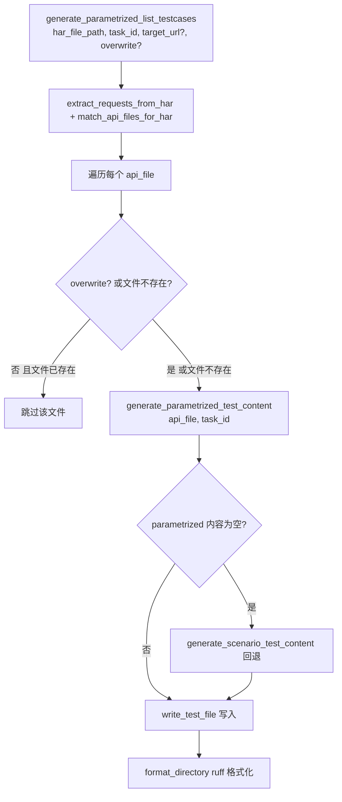
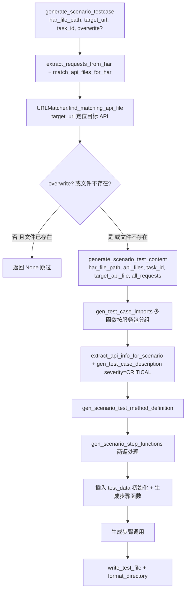
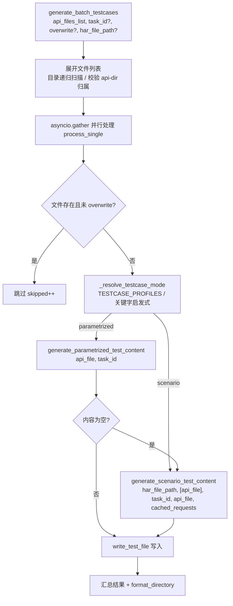

# 测试用例生成三种模式详解

## 概述

`TestCaseGenerator`（[testcase_generator.py](../har2pytest/testcase_generator.py)）提供三种测试用例生成模式，每种模式适用于不同的测试场景。
代码生成本身已按职责拆分到独立模块：参数化代码生成在 `parametrized_codegen.py`、场景代码生成在 `scenario_codegen.py`、参数项构建在 `param_builder.py`、时间对处理在 `time_pair.py`、场景步骤取值分析在 `step_values.py`，主类只负责编排。

| 模式 | 入口方法 | 参数来源 | 适用场景 |
|------|---------|---------|---------|
| **parametrized_list** | `generate_parametrized_list_testcases()` | api.json 元数据 | 列表查询接口的 pytest 参数化测试 |
| **complex_scenario** | `generate_scenario_testcase()` | HAR 文件 | 多步骤业务流程的链路测试 |
| **batch** | `generate_batch_testcases()` | API 文件 / HAR 文件 | 批量生成回归测试，逐接口自动决策模式 |

---

## 模式一：parametrized_list（列表查询参数化模式）

### 用途

为列表查询类接口生成 `@pytest.mark.parametrize` 参数化测试用例。枚举参数每个独立为一个测试方法，
逐值覆盖；非枚举参数走运行时取值路径（引用 `self.list_query_data["参数名"]`），不单独参数化。

### 调用链



### 详细步骤

#### Step 1: `generate_parametrized_list_testcases()`

```
输入: har_file_path, task_id, target_url?, overwrite=False
 └─ 解析 HAR → 匹配出对应 API 文件列表（未找到则返回空）
 └─ 遍历每个 api_file:
      ├─ target_url 指定时仅处理 URL 相等的接口
      ├─ overwrite=False 且测试文件已存在 → 跳过
      ├─ 调用 generate_parametrized_test_content() 生成内容
      │    └─ 内容为空 → 回退 generate_scenario_test_content()（场景模式）
      └─ write_test_file() 写入 f"test_{function_name}.py"
 └─ 有产出时 format_directory() 批量 ruff 格式化
```

#### Step 2: `generate_parametrized_test_content()`

```
输入: api_file, task_id
 └─ parse_api_file(api_file) → function_name, url, params, data, param_remarks, param_values 等
 └─ api_params = api_info.params + api_info.data（data 为 JSON 数组时显式报错，
      提示改用 complex_scenario；两者皆空时回退 har_params）
 └─ param_var_name = "data"（有 data/files）或 "params"（纯 query 接口）
 └─ merged_pv = api_info.param_values；为空时回退 api_info.har_param_values
 │
 ├─ [构建参数化条目 param_items]
 │  ├─ build_param_items_from_api(api_params, merged_pv, is_batch_mode=True)
 │  ├─ param_items 为空且 api_params 非空 → build_pagination_only_items 分页退化
 │  ├─ 单值枚举参数（候选值不足 2 个）→ 追加 {"param_name"}，走运行时取值路径
 │  ├─ 多值枚举参数 → 追加 {"param_name"}，参与 parametrize
 │  ├─ api_params 中剩余参数（分页/时间/常量参数除外）→ 追加 {"param_name"}
 │  └─ 时间对 start 参数 → 追加 {"param_name"}，生成 start/end 组合方法
 │
 ├─ [填充 other_params 与类型标记]
 │  └─ 每个 item：other_params = dict(api_params) + constant_params − 自身参数名，
 │     时间参数统一置 ""；数组类型参数（默认值为 list）记录 is_array_param=True
 │
 └─ [生成代码]
      ├─ gen_test_case_imports(service_package, function_name, task_id, is_list_query=True)
      ├─ gen_test_case_description(severity="NORMAL", param_remarks, api_headers)
      ├─ gen_list_query_data_class_attr(api_params, merged_pv, tp_ctx)
      ├─ gen_test_0_collect_response_data(api_params + constant_params，时间置 "")
      ├─ gen_batch_parametrized_test_methods(剔除单值参数的 param_values, time_pair_ctx)
      ├─ 有时间对时 insert_datetime_import() 补 datetime 导入
      └─ validate_python() 语法校验
```

#### Step 3: `build_param_items_from_api()`（[param_builder.py](../har2pytest/param_builder.py)）

```
输入: api_params, param_values, is_batch_mode
 └─ 第一遍：遍历 param_values 中有枚举值的参数（跳过分页/时间参数）→ 参数化项
 └─ 第二遍：遍历 api_params 中剩余参数（跳过分页/时间参数）
      ├─ batch 模式连空值参数一并收录；非 batch 模式仅收录有效值
      └─ 返回 [{"param_name": ...}, ...]（枚举值由下游通过 param_values 取用）
```

> **说明**：`param_values` 来自 api.json 预计算字段（Swagger 类型感知默认值 + HAR 派生枚举值），
> 生成阶段不再重新解析备注。HAR 分析阶段写入的 `constant_params`（>50% 请求同值的参数）不参与参数化，
> 作为固定值进入 `other_params`。

#### Step 4: `gen_batch_parametrized_test_methods()`（[parametrized_codegen.py](../har2pytest/parametrized_codegen.py)）

```
输入: param_items, param_values, param_remarks, time_pair_ctx
 └─ 遍历 param_items，跳过时间对 end 参数（由 start 组合方法覆盖）:
      ├─ [时间对 start 参数]
      │    └─ 合并 start/end 为单个方法，两端取值均引用 self.list_query_data
      ├─ [枚举参数]
      │    ├─ 组合参数（键含逗号且值首元素为 list/tuple）
      │    │    └─ 静态参数化列表 @pytest.mark.parametrize("a,b", [...])，
      │    │       other_params 排除子参数避免重复键
      │    ├─ 单参数
      │    │    └─ @pytest.mark.parametrize("x", list_query_data["x"]) 引用枚举值
      │    ├─ gen_test_method_definition(标题 + def 行)
      │    ├─ gen_test_method_body（数组类型参数渲染为 "x": [x]）
      │    └─ gen_test_method_assertions（搜索条件相等断言）
      └─ [非枚举参数]
           ├─ 方法体首项 "x": self.list_query_data["x"] 运行时取值
           └─ p_runtime_value_method.j2（带搜索条件断言）
```

### 关键机制

#### `list_query_data` 类属性

承载全部参数的运行期取值：

- **枚举参数**：多值保持列表（parametrize 逐值迭代）；单值解包为纯值；
  数组类型参数（api.json 默认值为 list）即使单值也保持列表
- **分页参数**：取 `PAGINATION_PARAMS` 配置默认值（如 pageNum=1、pageSize=10）
- **时间对参数**：datetime 动态计算（start 取当年 1 月 1 日，end 取当前时间）
- **其余参数**：Swagger 默认值

#### `test_0` 收集方法

`test_0_{function_name}` 发送一次默认查询，遍历响应把字段值收集进 `list_query_data`，
供后续运行时取值方法使用。

#### 数组类型参数（多选）

api.json 中默认值为 list 的参数（如 `manualInterventionReasons: []`）是数组类型。
parametrize 把候选值打散为标量逐个传入，方法体渲染时包回单元素数组
`"manualInterventionReasons": [manualInterventionReasons]`，保证请求体类型正确。

#### 搜索条件断言

枚举与非枚举参数方法都会校验响应字段与搜索条件一致：

```python
for item in items:
    if isinstance(item, dict):
        for k, v in item.items():
            if k.lower() == "manualinterventionreasons":
                if v is None:
                    continue
                assert v is None or str(v) == str(manualInterventionReasons), (
                    f"字段 {k} 值 {v} 与搜索条件 manualInterventionReasons={manualInterventionReasons} 不一致"
                )
```

### 生成的测试用例示例（异步模式，简化）

```python
import os

import allure
import pytest
from allure_commons.types import Severity

from har2pytest.client import async_client, client

client.set_client(async_client)

from apis.mall_mgmt_application import mgmt_order_exchange_getOrderExchangeList


@pytest.mark.test_list_query
@allure.severity(Severity.NORMAL)
@allure.feature("mall_mgmt_application")
@allure.story("/mgmt/order/exchange/getOrderExchangeList")
class TestClass:
    @property
    def headers(self):
        return {
            "authorization": f"bearer {os.environ.get('token', '')}",
            "GW-Client": "test",
        }

    list_query_data = {
        "applySource": [1, 2],
        "exchangeStatus": [1, 2, 3, 4, 5, 6, 7, 98, 99],
        "manualInterventionReasons": [1, 2, 3, 4, 5, 6, 7, 8, 9],
        "pageNum": 1,
        "pageSize": 10,
        # ... 其余参数取默认值
    }

    @allure.title("查询换货单列表: 获取响应数据")
    async def test_0_mgmt_order_exchange_getOrderExchangeList(self):
        params = {
            "applySource": None,
            "manualInterventionReasons": [],
            # ... 其余参数取默认值
        }
        async with mgmt_order_exchange_getOrderExchangeList(params=params, headers=self.headers) as r:
            assert r.status == 200
            data = await r.json()
            assert data["code"] == 200

    @pytest.mark.parametrize("manualInterventionReasons", list_query_data["manualInterventionReasons"])
    @allure.title("查询换货单列表: 人工介入原因（多选）1-AI审核不通过 查询")
    async def test_7_mgmt_order_exchange_getOrderExchangeList(self, manualInterventionReasons):

        params = {
            "manualInterventionReasons": [manualInterventionReasons],
            "applySource": None,
            "pageNum": 1,
            "pageSize": 10,
            # ... 其余参数取默认值
        }

        async with mgmt_order_exchange_getOrderExchangeList(params=params, headers=self.headers) as r:
            assert r.status == 200
            data = await r.json()
            assert data["code"] == 200
            # 搜索条件断言 ...
```

> 同步模式差异：不导入 async_client、不调用 `client.set_client`，方法为普通 `def`，
> 调用形式为 `with mgmt_xxx(...) as r:`，状态断言为 `r.status_code`，默认输出目录为 `testcases/sync/`。

---

## 模式二：complex_scenario（复杂场景流程模式）

### 用途

为多步骤业务流程生成场景化链路测试用例。每个步骤对应一个 `@allure.step` 嵌套函数，
测试数据通过用例级 `test_data` 字典在步骤间传递：前序步骤响应整存，后续步骤参数
按取值来源动态引用。

### 调用链



### 详细步骤

#### Step 1: `generate_scenario_testcase()`

```
输入: har_file_path, target_url, task_id, overwrite=False
 └─ 校验 HAR 文件存在 → 解析 HAR → 匹配 API 文件列表
 └─ URLMatcher.find_matching_api_file(target_url) → 目标 API 文件
 └─ overwrite=False 且测试文件已存在 → 返回 None 跳过
 └─ generate_scenario_test_content() → write_test_file() → format_directory()
```

#### Step 2: `generate_scenario_test_content()`

```
输入: har_file_path, api_files, task_id?, target_api_file?, requests?
 └─ requests 未显式传入时由 get_requests_from_source() 获取
 │    （HAR 文件优先；无 HAR 时从目标 API 文件构建单条模拟请求）
 ├─ gen_test_case_imports(api_files)：多函数模式，按服务包分组导入
 ├─ extract_api_info_for_scenario() → (feature_name=服务包名, story_name=API URL)
 ├─ gen_test_case_description(severity="CRITICAL")
 ├─ gen_scenario_test_method_definition(target_api_file)
 ├─ gen_scenario_step_functions() → 步骤函数名列表
 ├─ 生成步骤调用（async 模式加 await 前缀）
 └─ validate_python() 语法校验
```

#### Step 3: `gen_scenario_step_functions()` 两遍处理（[scenario_codegen.py](../har2pytest/scenario_codegen.py)）

```
输入: content, requests, api_files, class_headers
 └─ 第一遍：匹配 API 文件并分配步骤名/步骤键
      ├─ URLMatcher.find_matching_api_file() 匹配每个请求
      ├─ 从 API 文件 URL 模板提取路径参数（/orderInfo/{orderNo} → orderNo）
      ├─ gen_step_function_name()：同名 API 第二次起加计数前缀 step_1_xxx
      └─ make_step_key()：API 函数名按下划线取末两段作 test_data 键，冲突时向前扩展
 └─ build_scenario_value_plan() 分析取值计划（见 Step 4）
 └─ 开启 TRACK_PARAM_SOURCES 时，在第一个步骤前插入 test_data 初始化字典
 └─ 第二遍：逐步骤生成
      ├─ s_step_heading.j2：@allure.step("描述") + def step_xxx()
      ├─ gen_step_function_body()：files/data/params/无参数 四类调用
      ├─ 断言 + 被后续步骤引用的响应整存 test_data[步骤键] = data["data"]
      └─ 未被引用的响应不存储，避免无用数据常驻
```

#### Step 4: 步骤取值分析（[step_values.py](../har2pytest/step_values.py)）

每个步骤的响应 `data` 字段压平保存为「路径 → 叶子值」索引（最大深度 4），
后续步骤的传参按优先级确定取值来源：

| 来源 | 触发条件 | 生成的代码形态 |
|------|---------|--------------|
| **step_response** | 前序步骤压平叶子中存在「字段名（不分大小写）与值均相同」的叶子 | `test_data['步骤键']['路径']` 引用表达式 |
| **container_projection** | 容器参数（dict/list）与响应某子结构部分一致 | 逐字段生成引用表达式，不一致字段同名同值时提升为用例级 test_data，否则保留 HAR 录制值 |
| **test_data** | 未在前序响应中找到同名同值叶子的参数（含首步路径参数） | 生成 `test_data['参数名']` 引用，值集中在测试方法顶部的 test_data 初始化字典，便于用户修改 |
| **literal** | 空值或被忽略的参数 | 保持字面量原样输出 |

响应存储规则：每个步骤响应 `data` 一律整存（`test_data[步骤键] = data["data"]`），
不做任何裁剪；引用时携带完整路径（如 `test_data['product_search']['list'][0]['serialNo']`）。

#### headers 差异对比

类级 `headers` property 以目标 API 文件的 headers 为基准；每个步骤的
`build_step_headers_arg()` 将步骤自身 headers 与类级基准做差异对比：

- 无差异 → 直接 `headers=self.headers`
- 有差异 → 生成 `headers = {**self.headers, "差异项": ...}` 局部覆盖

### 生成的测试用例示例（同步模式，简化）

```python
import os

import allure
from allure_commons.types import Severity

from apis.mall_mgmt_application import (
    mgmt_order_cancelOrder,
    mgmt_order_orderInfo_orderNo,
)


@allure.severity(Severity.CRITICAL)
@allure.feature("mall_mgmt_application")
@allure.story("/mgmt/order/cancelOrder")
class TestClass:
    @property
    def headers(self):
        return {
            "channel": "pc",
            "authorization": f"bearer {os.environ.get('token', '')}",
        }

    @allure.title("取消订单")
    def test_mgmt_order_cancelOrder(self):

        # 初始化测试数据字典，用于在步骤间传递数据
        test_data: dict = {
            "orderNo": "SG014000261020000192",
        }

        @allure.step("取消订单")
        def step_mgmt_order_cancelOrder():

            data = {
                "orderNo": test_data["orderNo"],
                "remarks": "111",
            }

            with mgmt_order_cancelOrder(data=data, headers=self.headers) as r:
                assert r.status_code == 200
                data = r.json()
                assert data["code"] == 200
                test_data["order_cancelOrder"] = data["data"]

        @allure.step("订单信息")
        def step_mgmt_order_orderInfo_orderNo():

            params = {
                "orderNo": test_data["order_cancelOrder"]["orderNo"],
            }

            with mgmt_order_orderInfo_orderNo(params=params, headers=self.headers) as r:
                assert r.status_code == 200
                data = r.json()
                assert data["code"] == 200
                test_data["orderInfo_orderNo"] = data["data"]

        # 执行所有测试步骤
        step_mgmt_order_cancelOrder()
        step_mgmt_order_orderInfo_orderNo()
```

---

## 模式三：batch（批量生成模式）

### 用途

无需指定单个 URL，直接批量生成测试用例。输入可为 API 文件/目录/HAR 文件（逗号分隔混合），
每个接口的模式由 `_resolve_testcase_mode()` 决策：

1. **`TESTCASE_PROFILES` 配置命中且显式指定 `mode`**（推荐，见"模式配置化"）；
2. `mode=auto`/未配置 → 描述关键字启发式（命中 `LIST_QUERY_KEYWORDS` 且未被
   `LIST_QUERY_EXCLUDE_KEYWORDS` 排除 → parametrized）；
3. 关键字未命中时，接口携带参数（Swagger 或 HAR 捕获）默认走 parametrized，
   避免生成无参数的空壳场景用例；无参数接口 → scenario。

### 模式配置化（TESTCASE_PROFILES）

在 `har2pytest_config.json` 中按 URL 显式指定模式，消除"靠中文描述关键字判定"的脆弱点。
字段说明、示例与优先级见 [配置参考 → 测试模式配置](configuration.md#测试模式配置testcase_profiles)，
此处不再重复；命中逻辑为：精确路径 / `{param}` 模板 / 末尾 `*` 通配均可命中，
`mode=auto`（或缺省）时回落上面的关键字启发式，`keywords`/`exclude_keywords` 可覆盖全局默认。

### 输入类型

batch 模式支持两类输入（CLI 层解析，逗号分隔混合输入）：

| 输入类型 | 示例 | 说明 |
|---------|------|------|
| **API 文件/目录** | `apis/mobile_application` | 目录递归扫描 `.py` 文件，排除 `__init__.py` |
| **HAR 文件** | `api_request.har` | 解析 HAR 提取请求并匹配对应 API 文件，HAR 一并传入供场景模式取值 |
| **混合输入** | `apis/mobile,api_request.har` | 逗号分隔，两类输入可同时提供 |

> API 文件必须位于 `--api-dir` 目录下，否则无法推导 import 包名，整批直接失败。

### 调用链



### 详细步骤

#### Step 1: `generate_batch_testcases()`（异步 + 并行）

```
输入: api_files_list, task_id?, overwrite=False, har_file_path?
 └─ 展开路径: 目录 → 递归收集 .py 文件；普通文件 → 直接追加
 └─ 校验所有文件位于 api_dir 内（否则整批失败并提示 --api-dir）
 └─ 传入 HAR 文件时预先解析请求列表（供场景模式复用）
 └─ asyncio.gather 并行处理，每个 api_file 独立 process_single():
      ├─ 文件不存在 → "skipped"
      ├─ 无 function_name → "failed"
      ├─ 测试文件已存在且未 overwrite → "skipped"
      ├─ _resolve_testcase_mode(api_file) 决策模式
      │    ├─ parametrized → generate_parametrized_test_content()
      │    └─ scenario → generate_scenario_test_content()
      ├─ parametrized 内容为空 → 回退场景模式
      └─ write_test_file() 同步写入 → "generated"
 └─ 汇总 {total, skipped, generated, failed, generated_files}
 └─ 有产出时 format_directory() 批量 ruff 格式化
```

> **异步并行说明**：所有 API 文件通过 `asyncio.gather` 并发处理；`write_test_file` 为同步写盘，
> 由任务并行调度，真正的异步批量格式化在全部写完后由 `format_directory` 执行。

#### 与模式一/二的关键区别

batch 模式单独运行时没有单份 HAR 作为整个批量任务的输入；传入 HAR 文件时
其请求会先匹配对应 API 文件，参数化路径统一从 api.json 元数据读取参数值，
场景路径则消费该 HAR 的请求序列：

| 组件 | parametrized_list(batch) | complex_scenario(batch) |
|------|------------------------|------------------------|
| **参数来源** | `build_param_items_from_api(api_params, merged_pv)` 从 api.json 读取预计算枚举值 | HAR 请求序列（场景模式需要 HAR 输入） |
| **导入语句** | `import pytest` + 单函数导入 | 多函数按服务包分组导入（pytest/allure 两种模式均无条件导入） |
| **severity** | NORMAL | CRITICAL |
| **测试方法** | `@pytest.mark.parametrize` 参数化方法 + test_0 收集方法 | `@allure.step` 嵌套步骤函数 + test_data 传递 |
| **headers** | 目标 API 文件 headers 作为类级 property | 同左，步骤差异项局部覆盖 |
| **写入方式** | `write_test_file()` 同步写盘（任务并行） | 同左 |

---

## 三种模式对比总结

| 维度 | parametrized_list | complex_scenario | batch |
|------|------------------|-----------------|-------|
| **输入** | HAR + API 文件（参数从 api.json 元数据读取） | HAR + API 文件 | API 文件列表/目录 或 HAR 文件（混合） |
| **参数来源** | api.json 元数据（param_values + har_param_values） | HAR 请求（按业务流程顺序）+ 前序响应动态引用 | 逐接口决策：parametrized 用 api.json，scenario 用 HAR |
| **是否需要 HAR** | 是（匹配 API 文件用） | 是 | 否（支持 HAR 输入） |
| **输出** | 每匹配 API 一个文件（CLI 传 `--url` 时为一个） | 单文件 | 多文件（每 API 一个） |
| **overwrite 参数** | 跳过已存在文件 | 返回 None 跳过 | 跳过已存在文件 |
| **测试框架** | pytest + allure | pytest + allure | pytest + allure |
| **参数化** | `@pytest.mark.parametrize` 引用 list_query_data | 无参数化 | 列表接口有 |
| **severity** | NORMAL | CRITICAL | NORMAL / CRITICAL |
| **导入 pytest** | 是 | 是 | 是（两种模式均无条件导入 pytest/allure） |
| **headers** | API 文件自定义（类级 property） | 同左 + 步骤差异覆盖 | 同左 |
| **用途** | 单个查询接口多参数覆盖 | 完整业务流程链路验证 | 批量生成回归测试 |

---

## 公共辅助方法

三种模式共享的模块级函数：

| 函数 | 所在模块 | 功能 | 被调用者 |
|------|---------|------|---------|
| `parse_api_file()` | `utils.py` | API 文件解析（带缓存，.py → 同名 .api.json） | 所有模式 |
| `extract_service_package()` | `utils.py` | 从路径提取服务包名 | 所有模式 |
| `gen_test_case_imports()` | `parametrized_codegen.py` | 生成导入语句（单函数/多函数分组） | 所有模式 |
| `gen_test_case_description()` | `parametrized_codegen.py` | 生成 allure 描述（severity/备注/headers） | 所有模式 |
| `build_param_items_from_api()` | `param_builder.py` | 构建参数化条目 | parametrized |
| `TimePairContext.build()` | `time_pair.py` | 时间对查找表与角色映射 | parametrized |
| `get_requests_from_source()` | `scenario_codegen.py` | HAR/API 文件二选一获取请求序列 | scenario |
| `gen_scenario_step_functions()` | `scenario_codegen.py` | 场景步骤函数生成（两遍处理） | scenario |
| `build_scenario_value_plan()` | `step_values.py` | 分析步骤取值计划（step_response/container_projection/test_data/literal） | scenario |
| `write_test_file()` | `utils.py` | 写盘（含输出目录创建） | 所有模式 |
| `format_directory()` | `utils.py` | 目录级 ruff 格式化 | 所有模式 |
| `validate_python()` | `codegen.py` | 写盘前 ast.parse 语法校验 | 所有模式 |
